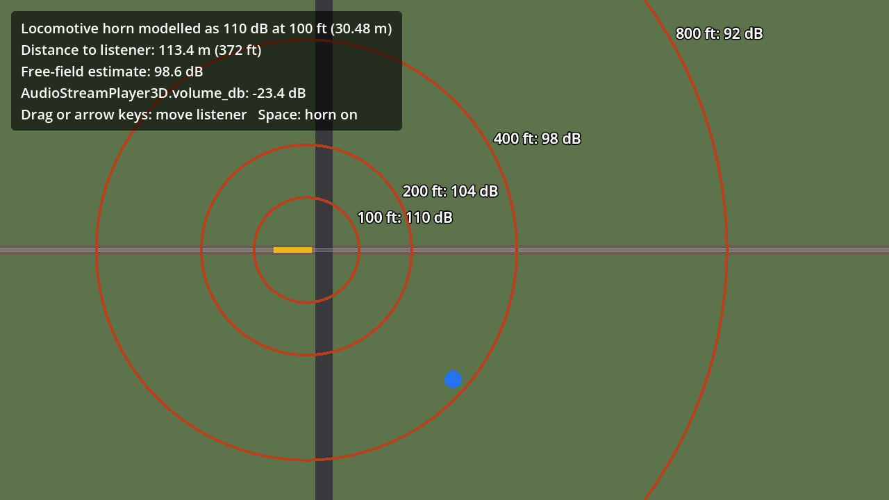

# Sound Falloff for Godot 4

Real-world distance loudness for Godot 4. The `sound_falloff` addon gives you:

- **`SoundFalloff`**: static GDScript helpers for the free-field inverse-square law: level at a distance, the distance for a target level, dB to amplitude/power and back, adding levels of several sources, and an optional air-absorption term.
- **`AudioDistanceAttenuator`**: a node you add under an `AudioStreamPlayer3D`. Every frame it sets `volume_db` from the distance to the listener, relative to a reference distance, with an optional min/max clamp.
- **A demo scene**: a locomotive horn at a grade crossing and a listener you drag around. The horn chord is synthesized in code with `AudioStreamGenerator`, so the demo ships with no audio files.



Godot's built-in attenuation models (inverse, inverse square, logarithmic) are tuned for game feel and scaled by `unit_size`. This addon is for the cases where you want the physical rule instead: a level of X dB at a reference distance that falls by 6.02 dB per doubling of distance. That is useful for simulations, training tools, sirens and horns, or simply predictable mixing.

## Install

1. Copy `addons/sound_falloff/` into your project (or install it from the Godot Asset Library / Asset Store).
2. Enable **Sound Falloff** in *Project > Project Settings > Plugins*. The classes are registered with `class_name`, so they also work without enabling the plugin.

Tested with **Godot 4.7.2** (the version the test suite runs on). The code uses typed GDScript only and no C++ or GDExtension.

## The formula

```
L(d) = L_ref - 20 * log10(d / d_ref) - alpha * (d - d_ref) / 1000
```

`L_ref` is the level at the reference distance `d_ref`, and `alpha` is an optional air absorption in dB per km (distances in metres for that term). Example: a horn rated 150 dB at 10 ft is about 130 dB at 100 ft.

## `SoundFalloff` usage

```gdscript
# 150 dB at 10 ft -> level at 100 ft (any unit works, as long as both distances use it).
var db := SoundFalloff.level_at_distance(150.0, 100.0, 10.0)   # 130.0

# Where does it drop to 90 dB?
var d := SoundFalloff.distance_for_level(150.0, 90.0, 10.0)     # 10000.0 (ft)

# The same with air absorption at 500 Hz. The last argument says how many
# metres one distance unit is (only the absorption term needs metres).
var alpha: float = SoundFalloff.AIR_ABSORPTION_DB_PER_KM[500]   # 1.9 dB/km
var far := SoundFalloff.level_at_distance(150.0, 1000.0, 10.0, alpha, SoundFalloff.METERS_PER_FOOT)  # ~109.43

# Two equal horns add about 3 dB, not double the decibels.
var both := SoundFalloff.combine_levels([100.0, 100.0])          # ~103.01

SoundFalloff.attenuation_db(20.0, 10.0)   # -6.02 (level change for a doubling)
SoundFalloff.db_per_doubling()            # 6.0206
SoundFalloff.db_to_amplitude(-6.0206)     # 0.5
SoundFalloff.power_to_db(0.5)             # -3.0103
```

Invalid input (distance <= 0, NaN, negative absorption, an empty list) reports a `push_error` and returns `NAN`.

## `AudioDistanceAttenuator` usage

1. Add an `AudioStreamPlayer3D` with your sound.
2. Add an `AudioDistanceAttenuator` as its child.
3. Set **Reference Distance** (world units) and **Reference Volume dB** (the `volume_db` you want at that distance).
4. Optional: set **Listener Path** to an `AudioListener3D` or any `Node3D`. Empty means the viewport's current camera.

| Property | Default | Meaning |
|---|---|---|
| `player_path` | parent | The `AudioStreamPlayer3D` to drive |
| `listener_path` | current `Camera3D` | Where the listener is |
| `reference_distance` | 1.0 | Distance at which `reference_volume_db` applies |
| `reference_volume_db` | 0.0 | `volume_db` at the reference distance |
| `absorption_db_per_km` | 0.0 | Optional air absorption |
| `world_unit_in_meters` | 1.0 | Metres per world unit (absorption term only) |
| `min_distance` | 0.1 | Distances below this are treated as this (no infinite level at 0) |
| `use_clamp`, `min_volume_db`, `max_volume_db` | on, -80, 6 | Clamp the result |
| `disable_builtin_attenuation` | on | Sets the player's `attenuation_model` to *Disabled* so Godot's curve is not applied on top |
| `auto_update` | on | Update every frame; turn off and call `update_volume()` yourself |

It also has `volume_db_for_distance(d)`, `get_last_distance()` and a `volume_updated(distance, volume_db)` signal.

From code:

```gdscript
var attenuator := AudioDistanceAttenuator.new()
attenuator.reference_distance = 30.48     # 100 ft in metres
attenuator.reference_volume_db = -12.0
attenuator.max_volume_db = 0.0
$Horn.add_child(attenuator)
```

## Demo

Open the project folder in Godot and run it (`addons/sound_falloff/demo/crossing_demo.tscn` is the main scene; it ships inside the addon folder, so you can also open it in your own project). The horn is modelled as 110 dB at 100 ft, the upper limit that US rules (49 CFR 229.129) set for a locomotive horn measured 100 ft ahead of the locomotive. Drag with the left mouse button or use the arrow keys to move the listener; Space toggles the horn. The HUD shows the distance, the free-field estimate in dB and the `volume_db` the node sets. The sound is a synthesized five-note chord played in the grade-crossing pattern (long, long, short, long); it is not a recording of a real horn.

## Tests

The test runner needs no framework:

```sh
godot --headless --path . --import
godot --headless --path . -s res://tests/run_tests.gd
```

It runs 15 test groups (core vectors such as 150 dB at 10 ft -> 130.0 dB at 100 ft, the absorption and bisection cases, round trips, conversions, invalid input, the node with clamp/signal/missing listener, and a demo smoke test) and exits with code 0 when all pass. The reference values come from the tested Python core [trainhorn-calc](https://github.com/train-horn/trainhorn-calc), which uses the same formulas. Lines starting with `ERROR: SoundFalloff:` in the log are expected: they come from the invalid-input tests.

## Limitations

- **Free field only.** No ground reflection, walls, barriers, wind or temperature gradients. Real outdoor levels can be several dB higher or lower.
- **Point source.** Very close to a large source (within one or two source sizes) the inverse-square law does not hold; `min_distance` avoids the singularity but does not model the near field.
- **Air absorption is broadband here.** Real absorption depends on frequency, temperature and humidity. The table holds rounded typical values (10 degC, 70 % RH, octave bands) and is a rough guide only; the node does not filter high frequencies.
- **`volume_db` is not SPL.** The node maps a real-world level change onto your mix. Pick `reference_volume_db` so the loudest case does not clip, and use the clamp.
- **Estimates, not measurements**, and not a legal noise assessment.
- Only `AudioStreamPlayer3D` is supported by the node. For 2D, call `SoundFalloff.level_at_distance()` yourself.

## More

To check numbers in a browser, the [decibel distance calculator](https://train-horn.com/tools/decibel-distance/) runs the same free-field formula for a horn rated at 10 ft (no air absorption).

## License

MIT, see [LICENSE](LICENSE). Copyright (c) 2026 Train Horn. The addon folder carries its own copy of the license.

Made by [Train Horn](https://train-horn.com/), an independent reference on train horns.
